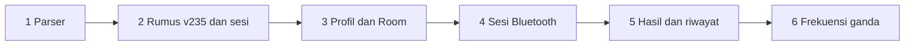

# Rencana besar eksekusi HealthTrack

Tahap pertama adalah satu sesi ukur OKOK di [HealthTrack](../../HealthTrack). Isi produk, keputusan, dan pintu keluar ada di [rencana aplikasi Android](../rencana-aplikasi-android.md). Dokumen ini memecah urutan itu menjadi enam fase. Tiap fase punya berkas sendiri di folder ini.

Letak paket di folder ini yang dipakai saat menulis kode. Bagian paket di rencana aplikasi masih menyebut `domain/protocol` dan templat kosong; itu tidak lagi sesuai kode. Parser fase 1 dan rumus `v235` sudah ada. Layar, Room, DataStore, Bluetooth, dan `vA019` belum.

## Keadaan modul

Satu modul Gradle: `include(":app")` di [settings.gradle.kts](../../HealthTrack/settings.gradle.kts). Namespace `com.mascill.healthtrack`, minSdk 28, targetSdk 36, `compileSdk` 37.0. Kotlin `2.2.10`, AGP `9.2.1`, Hilt `2.60.1`. Sumber Kotlin ada di `app/src/main/java`, bukan `src/main/kotlin`. Berkas Kotlin baru ditaruh di source set yang sama.

[`MainActivity`](../../HealthTrack/app/src/main/java/com/mascill/healthtrack/MainActivity.kt) masih layar sapaan templat. Tema yang ada adalah `ui/theme/HealthTrackTheme`. Hilt sudah terpasang lewat [`App`](../../HealthTrack/app/src/main/java/com/mascill/healthtrack/App.kt).

supabase-kt, OkHttp, Retrofit, Room, DataStore, Navigation 3, dan plugin serialization belum di katalog. Enam fase ini tidak memasang supabase-kt, OkHttp, atau Retrofit: tidak ada Auth atau CRUD server di tahap ini. Retrofit dan Moshi tidak ditambah. Room, DataStore, Navigation 3, dan `kotlinx.serialization` masuk di fase 3.

## Selesai artinya

Satu pengukuran di timbangan yang sama dengan uji 27 Sep 2026: berat dan daftar indeks cocok dengan aplikasi OKOK, profil tubuh tersimpan, hasil tetap ada setelah aplikasi ditutup. Jalur itu satu nilai ohm (`v235`). Sepuluh nilai ohm (`vA019`) adalah fase 6, sesudah tahap satu frekuensi lolos.

Di luar keenam fase: dapur, minum, olahraga, wearable, tali, puasa, VIP, iklan, analitik, PDF, akun server Chipsea, kunci siaran terenkripsi, dan `libprotocol.so`.

## Urutan

Fase berikutnya dimulai setelah pintu keluar fase berjalan terpenuhi. `./gradlew :app:testDebugUnitTest` adalah pemeriksaan JUnit di komputer. Uji timbangan nyata hanya ada di fase 4.



| Fase | Berkas | Keadaan | Pintu keluar singkat |
|---|---|---|---|
| 1 | [fase-01-modul-inti-parser.md](fase-01-modul-inti-parser.md) | Sudah di kode | Uji iklan, siaran, dan GATT lulus di JUnit host |
| 2 | [fase-02-rumus-v235-mesin-sesi.md](fase-02-rumus-v235-mesin-sesi.md) | Sudah di kode | v235 dan mesin sesi satu ohm lulus; angka layar 68,7 kg cocok |
| 3 | [fase-03-profil-room.md](fase-03-profil-room.md) | Belum | Profil tersimpan, baris terbaru termuat, sesi terkunci tanpa profil |
| 4 | [fase-04-sesi-bluetooth.md](fase-04-sesi-bluetooth.md) | Belum | Berat dan indeks cocok dengan OKOK di timbangan yang sama |
| 5 | [fase-05-hasil-riwayat.md](fase-05-hasil-riwayat.md) | Belum | Satu hasil tersimpan, muncul di riwayat, tetap ada setelah aplikasi ditutup |
| 6 | [fase-06-frekuensi-ganda.md](fase-06-frekuensi-ganda.md) | Belum | Sepuluh ohm memilih `vA019` dan uji Python-nya lulus |

Fase 5 menutup tahap pertama untuk timbangan satu frekuensi. Fase 6 menutup timbangan yang mengirim sepuluh ohm.

## Aturan yang mengikat kode baru

Aturan di `HealthTrack/.cursor/rules/` dipakai untuk fase 2–6. Penyesuaian yang sudah terkunci di kode:

- Lapisan: `presentation` memakai `domain`. `data` memakai `domain`. Kelas di `domain/usecase` tidak mengimpor `data`, `presentation`, `android.*`, Room, Compose, atau `dagger.hilt`. `dagger.hilt` untuk use case hanya di `domain/di`.
- Use case disediakan `@Provides` di [`UseCaseModule`](../../HealthTrack/app/src/main/java/com/mascill/healthtrack/domain/di/UseCaseModule.kt). Konstruktor use case tidak memakai `@Inject`.
- Modul Hilt data ada di `com.mascill.healthtrack.data.di`. Paket `com.mascill.healthtrack.di` tidak dibuat. [`RepositoryModule`](../../HealthTrack/app/src/main/java/com/mascill/healthtrack/data/di/RepositoryModule.kt) mengikat implementasi data dan menandai `MeasurementRepository` sebagai optional sampai Room mengikatnya. [`DataModule`](../../HealthTrack/app/src/main/java/com/mascill/healthtrack/data/di/DataModule.kt) menyediakan parser. `DataStoreModule`, `DatabaseModule`, dan `DispatcherModule` menyusul di paket yang sama pada fase 3.
- Nama kelas, fungsi, dan properti Kotlin berbahasa Inggris. Teks layar berbahasa Indonesia.
- ViewModel memakai `@HiltViewModel`, `StateFlow`, dan `collectAsStateWithLifecycle`. Layar mengambil ViewModel lewat `androidx.hilt.lifecycle.viewmodel.compose.hiltViewModel`. Navigation 3 (`NavDisplay`, `NavKey`), bukan `NavHost`.
- Paket `domain` berisi `model`, `repository`, `usecase`, dan `di`. Jangan menambah `domain/formula` atau `domain/session`.
- Paket `model` hanya tipe, termasuk keadaan `MeasurementSession`. Rumus `CsBiasV235` ada di `util`, bersama `f32` dan `fma`. Satu use case memuat satu fungsi publik, `invoke`. Use case boleh memanggil use case lain. `*RepositoryImpl` hanya menyimpan dan membaca.
- Satu fitur satu paket `presentation/[feature]/` berisi `*Screen`, `*ViewModel`, `model/*UIState`, dan `component/` bila perlu. ViewModel profil dan riwayat menerima antarmuka di `domain/repository`. ViewModel tidak menerima `*RepositoryImpl`.
- Kesalahan yang tampil ke pengguna memakai `AppError` di `presentation/common/model`, mulai fase yang pertama kali menampilkan pesan itu.
- SDK supabase tidak masuk `domain` atau `presentation`. Tahap ini tidak memasangnya sama sekali.

## Letak kode

Yang ada sekarang:

```text
HealthTrack/app/src/main/java/com/mascill/healthtrack/
  domain/model/                 ScaleTransmission, ScaleGatt, GattConfirmation, kesalahan format,
                                BodyData, BiasV235Data, V235Report, MeasurementResult, MeasurementDisplay,
                                MeasurementSession
  domain/repository/            ScaleTransmissionRepository, ScaleGattRepository, MeasurementRepository
  domain/di/                    UseCaseModule
  domain/usecase/               CalculateReportUseCase, AcceptTransmissionUseCase, AcceptGattUseCase,
                                ApplyBroadcastWeightUseCase, CloseMeasurementUseCase,
                                MeasurementStateUseCase, DisplayMeasurementUseCase
  util/                         CsBiasV235, BinaryFloat (`f32`, `fma`)
  data/datasource/              NativeProtocol
  data/di/                      ScaleFrameHeaders, DataModule, RepositoryModule
  data/mapper/                  TransmissionMapper, GattMapper, WeightMapper
  data/model/                   RawTransmission, RawGattMeasurement, RawGattConfirmation
  data/repository/              ScaleTransmissionRepositoryImpl, ScaleGattRepositoryImpl
    transmission/               pembaca 0xCA, 0xC0, dan 0xFF
    gatt/                       GattParser serta frame versi 16 dan 17
  data/util/                    ProtocolUtils, Constants, TxConst, GattConst, TxIdx, GIdx, RIdx
  ui/theme/                     HealthTrackTheme
  App.kt
  MainActivity.kt
HealthTrack/app/src/main/cpp/   libscale_protocol.so
HealthTrack/app/src/test/java/  JUnit host, tanpa emulator
```

Yang ditambah fase 3–6, masih di modul `app`:

```text
util/                           CsBiasVA019
domain/repository/              BodyRepository, ScaleSessionRepository
data/model/entity/              entitas Room body dan measurement
data/datasource/local/          DAO Room dan DataStore healthtrack_prefs
data/ble/                       BleSession dan SessionListener, fase 4
presentation/navigation/        NavDisplay, NavKey
presentation/profile/           fase 3
presentation/session/           fase 3–4
presentation/history/           fase 3 dan 5
presentation/result/            fase 4–5
presentation/common/            AppError dan komponen bersama
util/                           AppDispatcher
```

Modul Gradle kedua tidak dibuat. Rumus dan mesin sesi tidak mengimpor `android.*`. Uji mereka ada di `src/test/java` dan jalan lewat `./gradlew :app:testDebugUnitTest`.

## Lapisan native

Operasi byte parser yang sudah pindah ada di `libscale_protocol.so` (`app/src/main/cpp/`). [`NativeProtocol`](../../HealthTrack/app/src/main/java/com/mascill/healthtrack/data/datasource/NativeProtocol.kt) di `data.datasource` memuat library itu. Simbol JNI berawalan `Java_com_mascill_healthtrack_data_datasource_NativeProtocol_`.

Yang di C untuk parser: byte, berat siaran, penjepit komposisi GATT (`setAxunge` dan saudaranya), parse frame `0xCA` / `0xC0` / `0xFF`, parse GATT versi 16 dan 17, serta muatan iklan. Rumus laporan tidak di C. `v235` ada di `util` (`CsBiasV235`). `vA019` belum dipindahkan.

Dua jalur, dipilih `NativeProtocol.isLoaded`:

- Android: native C lewat JNI.
- JUnit host: pembaca Kotlin di `data/repository/transmission` dan `data/repository/gatt`. `.so` ARM tidak dimuat di JVM macOS/Linux.

Model domain dibangun di mapper pada kedua jalur. `GattParser` (buffer paket) tetap di Kotlin, satu instance sesi dari `DataModule.gattParser`. `parseGatt` membuat `GattParser` baru tiap frame. Teks `scaleText` dan `javaFloatText` tetap di Kotlin.

## Penyimpanan dan layar

Preferensi: DataStore `healthtrack_prefs` di `data/datasource/local`. Prefs tidak menyimpan baris ukur dan tidak menyimpan token.

Profil dan hasil: Room, tabel `body` dan `measurement`, padanan [Penyimpan](../../aplikasi/simpan.py) (`tubuh` dan `ukur`). Nama tabel Android memakai bahasa Inggris. Jangan membuat tabel `tubuh` atau `ukur`.

Layar memakai Navigation 3 saat fase 3 menambah tujuan. Versi ditambahkan ke `HealthTrack/gradle/libs.versions.toml` pada rilis yang cocok dengan Kotlin `2.2.10`. AGP dan Kotlin yang ada tidak diturunkan.

## Yang dipakai bersama

- Peta byte: [protokol frame OKOK](../protokol-frame-okok.md).
- Definisi selesai: [definisi-selesai.md](../definisi-selesai.md).
- Bluetooth: `HealthTrack/.cursor/rules/bluetooth.mdc`.
- Operasi rumus mengikuti urutan `rumus/*.py`. `CsBiasV235`, `f32`, dan `fma` ada di `util`. Operasi yang di Python dipaksa binary32 memakai `Float`. Nilai library `cs_bias_v235` sebelum penyempitan tetap `Double`. `data/util/ProtocolUtils.f32` milik parser, bukan rumus laporan.
- Angka pembanding layar: berat 68,7 kg, tinggi 166 cm, umur 29, kelamin 1, impedansi 600 ohm. Kelamin 0 pada vektor yang sama menghasilkan lemak 34,8. Pemetaan field ada di fase 2.
- Siaran `0xC0` dengan bit 7 pada byte offset 4 ditolak lewat `EncryptedTransmissionError`. Repositori tidak memuat kunci `okok_scale_encrypted_key_`.
- Sesi tidak menulis ke karakteristik TX.
- [`getVFR`](../../ScaleHealtSource/jadx-protocol/sources/com/chipsea/code/algorithm/CsAlgoBuilder.java) tidak dipindahkan. Viseral laporan v235 adalah field `vfl`. Pemanggilan `getVFR` di sumber ada pada skor umur, untuk jalur yang bukan frekuensi ganda:

```1386:1389:ScaleHealtSource/jadx-protocol/sources/com/chipsea/code/algorithm/CsAlgoBuilder.java
        if (getType() == Type.DualFrequency || getType() == Type.MultiFrequency) {
            sbc = getSbc();
        } else {
            float scoreWithAge = getScoreWithAge(this.H, this.Wt, this.Sex, this.Age, getBFR(), getSLM(), getVFR());
```

## Risiko yang mengikat urutan

- Urutan float mengikuti Python. Uji membandingkan keluaran yang sudah tercatat, termasuk vektor 68,7 kg.
- Pemindaian dan `connectGatt` tidak berjalan bersamaan.
- Timbangan yang masih tersambung ke aplikasi OKOK menolak GATT. Layar sesi menyebut itu bila waktu sambungan habis.
- Frame GATT riwayat tidak menimpa berat sesi yang sedang berjalan.
- `cs_bias_vA019.py` memuat interpreter program (sekitar dua ribu baris). Itu fase 6, sesudah satu ohm terbukti di timbangan.
