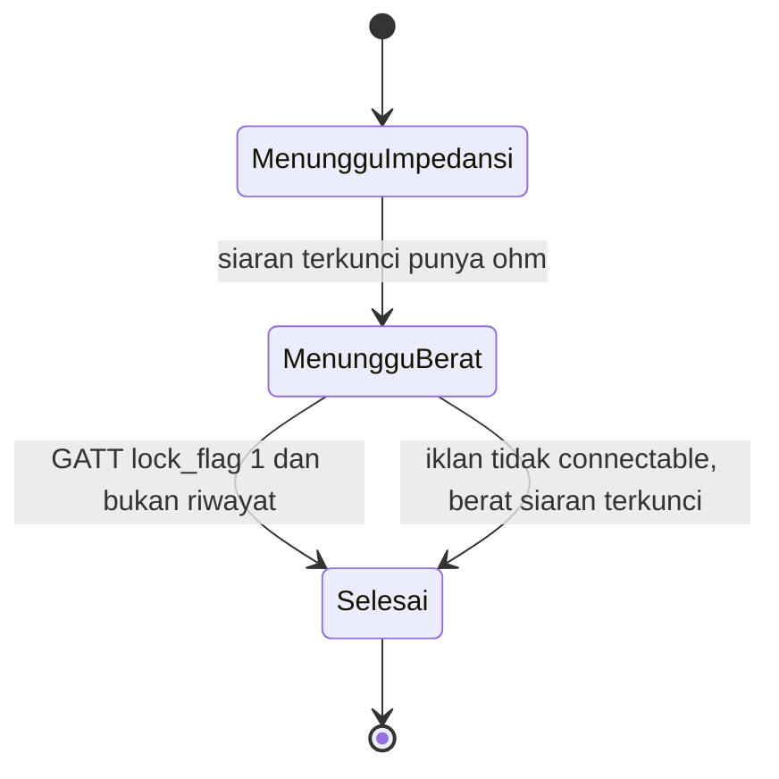

# Rencana aplikasi Android

Eksekusi per fase ada di [android-dev/00-rencana-besar.md](android-dev/00-rencana-besar.md).

Tahap pertama [HealthTrack](../HealthTrack) adalah satu sesi ukur OKOK di ponsel. Cakupan ini mengikuti [definisi selesai](definisi-selesai.md): kenali siaran, baca berat, sambung GATT, hitung komposisi dari rumus yang sudah ditulis ulang, simpan profil tubuh, dan simpan hasil ukur.

HealthTrack sekarang templat Compose kosong. Namespace `com.mascill.healthtrack`, minSdk 28, targetSdk 36, satu `MainActivity`. Perilaku yang diikuti sudah jalan di Python: [sesi ukur](../aplikasi/sesi_ukur.py), [sesi Bluetooth](../aplikasi/sesi_ble.py), [penyimpan](../aplikasi/simpan.py), dan paket [rumus](../rumus).

Modul produk lain menunggu sampai sesi ini lolos uji di timbangan yang sama. Dapur, minum, olahraga, wearable, tali, puasa, VIP, iklan, analitik, PDF, dan akun server Chipsea ada di luar dokumen ini.

## Keputusan

- HealthTrack satu modul Gradle, yaitu `app`. Parser, rumus, dan mesin sesi ditulis dalam Kotlin murni di paket `domain` dan tidak mengimpor `android.*`. Uji JUnit ada di `app/src/test` dan berjalan di komputer, tanpa emulator. Compose, Room, dan Bluetooth tetap di modul yang sama.
- Operasi rumus memakai `Float` (IEEE-754 binary32) dengan urutan operasi yang sama dengan `rumus/*.py`. Angka pembanding diambil dari keluaran Python yang sudah cocok dengan layar OKOK.
- Bluetooth memakai `BluetoothLeScanner` dan `BluetoothGatt`.
- Preferensi lokal memakai DataStore, nama `healthtrack_prefs`. Profil tubuh dan hasil ukur memakai Room, dengan dua tabel yang setara [Penyimpan](../aplikasi/simpan.py). Prefs tidak menyimpan baris ukur.
- Jalur satu impedansi (`v235`) dibangun dan diuji di timbangan dulu. Timbangan yang sudah dicocokkan mengirim satu nilai ohm. `vA019` (sepuluh nilai) menyusul sebagai fase sendiri.
- Siaran `0xC0` dengan bit enkripsi (bit 7 pada byte offset 4) ditolak. Rilis pertama tidak memuat kunci `okok_scale_encrypted_key_`. Keputusan itu ada di [definisi selesai](definisi-selesai.md).
- Angka komposisi di dalam paket GATT tidak mengisi laporan. Laporan diisi [`parse_default_z`](../rumus/cs_bias_v235.py) atau, pada fase frekuensi ganda, [`parse_multi_frequency`](../rumus/cs_bias_vA019.py).
- Sesi tidak menulis ke karakteristik TX.

[`getVFR`](../ScaleHealtSource/jadx-protocol/sources/com/chipsea/code/algorithm/CsAlgoBuilder.java) tidak dipindahkan. [`parse_default_z`](../rumus/cs_bias_v235.py) menyimpan viseral dari field native `VFR`. Skor di jalur laporan v235 tidak memakai method Java itu. Pemanggilan `getVFR` ada di skor umur CsAlgoBuilder, untuk jalur yang bukan frekuensi ganda:

```1386:1389:ScaleHealtSource/jadx-protocol/sources/com/chipsea/code/algorithm/CsAlgoBuilder.java
        if (getType() == Type.DualFrequency || getType() == Type.MultiFrequency) {
            sbc = getSbc();
        } else {
            float scoreWithAge = getScoreWithAge(this.H, this.Wt, this.Sex, this.Age, getBFR(), getSLM(), getVFR());
```

`libprotocol.so` hanya untuk perangkat Xiangshan atau `KAYOFIT_CS8`. Library bias Chipsea tidak dipanggil dari aplikasi.

## Paket

```text
HealthTrack/app/
  domain/
    protocol/    iklan, siaran, GATT
    formula/     v235, lalu vA019
    session/     BodyData, MeasurementSession, MeasurementResult
  data/
    local/       DataStore prefs dan Room
    ble/         pemindai + sambungan
  presentation/  profil, sesi, hasil, riwayat
```

| Python | Kotlin |
|---|---|
| `rumus/iklan_okok.py` | `app/.../domain/protocol/ScaleAdvertisement.kt` |
| `rumus/siaran_okok.py` | `app/.../domain/protocol/ScaleBroadcast.kt` |
| `rumus/gatt_okok.py` | `app/.../domain/protocol/ScaleGatt.kt` |
| `rumus/cs_bias_v235.py` | `app/.../util/CsBiasV235.kt` |
| `rumus/cs_bias_vA019.py` | `app/.../util/CsBiasVA019.kt` |
| `aplikasi/sesi_ukur.py` | `app/.../domain/session/MeasurementSession.kt` |
| `aplikasi/sesi_ble.py` | `app/.../data/ble/SessionListener.kt` dan `BleSession.kt` |
| `aplikasi/simpan.py` | `app/.../data/` Room |

Peta byte ada di [protokol frame OKOK](protokol-frame-okok.md).

## Alur satu sesi

Mesin sesi tetap [`SesiUkur`](../aplikasi/sesi_ukur.py). Bluetooth hanya mengantarkan byte.



Aturan yang sudah terbukti di Python:

1. Simpan alamat siaran OKOK pertama. Iklan lain diabaikan setelah alamat itu terpasang.
2. Impedansi laporan adalah `impedance_ohm` pada siaran terkunci (`0xCA` versi 32 atau `0xC0` tanpa bit enkripsi).
3. Sambungan dimulai pada siaran OKOK pertama yang `ScanResult.isConnectable()` benar. Kunci impedansi bukan syarat sambungan. Mode ini [`getConnectMode`](../ScaleHealtSource/jadx-protocol/sources/com/chipsea/btlib/util/ConfigurableDeviceUtil.java), yaitu FSAC kecuali ponsel Xiaomi yang `DEVICE`-nya diawali `HM`.

```23:26:ScaleHealtSource/jadx-protocol/sources/com/chipsea/btlib/util/ConfigurableDeviceUtil.java
    public static CsBtUtil_v11.CONNECT_MODE getConnectMode() {
        CsBtUtil_v11.CONNECT_MODE connect_mode = CsBtUtil_v11.CONNECT_MODE.FSAC;
        return (Build.BRAND.toLowerCase().equals("xiaomi") && Build.DEVICE.startsWith("HM")) ? CsBtUtil_v11.CONNECT_MODE.Alway_Conn : connect_mode;
    }
```

4. Hentikan pemindaian, lalu `connectGatt(autoConnect = false)`. Di macOS, sambungan yang jalan bersama pemindaian habis waktu. Android mengikuti urutan yang sama.
5. Temukan layanan Chipsea, pasang notify pada RX, tulis descriptor CCCD, lalu nyalakan pemindaian lagi supaya impedansi terkunci tetap masuk. UUID itu [`BtGattAttr`](../ScaleHealtSource/jadx-protocol/sources/com/chipsea/btlib/model/BtGattAttr.java):

```44:46:ScaleHealtSource/jadx-protocol/sources/com/chipsea/btlib/model/BtGattAttr.java
        CHIPSEA_SERVICE_UUID = "0000fff0-0000-1000-8000-00805f9b34fb";
        CHIPSEA_CHAR_RX_UUID = "0000fff1-0000-1000-8000-00805f9b34fb";
        CHIPSEA_CHAR_TX_UUID = "0000fff2-0000-1000-8000-00805f9b34fb";
```

6. Berat yang disimpan adalah frame GATT `lock_flag == 1` dan `history == false`. Berat GATT yang sudah masuk tidak diganti oleh berat siaran.
7. Jika iklan bertanda tidak bisa disambung, tutup sesi dari berat siaran terkunci (`pakai_berat_siaran`).
8. Tutup sesi hanya bila rumus mengembalikan kode 0. Satu nilai ohm memakai v235. Sepuluh nilai memakai vA019. Jumlah lain menolak sesi.
9. Tiga percobaan sambungan, batas 15 detik, lalu paling banyak dua putaran pindai. Sesi berakhir pada 120 detik atau saat hasil tersimpan.
10. Jika waktu sambungan habis, layar memberi tahu bahwa aplikasi OKOK di ponsel perlu ditutup bila timbangan sedang tersambung di sana.

Di Android, alamat yang disimpan adalah MAC radio. Di macOS, Python menyimpan UUID CoreBluetooth. Pembanding hasil tetap berat dan komposisi.

## Layar

Empat layar, navigasi Compose, teks Indonesia.

1. **Profil.** Tinggi (cm), umur, jenis kelamin (0 perempuan, 1 laki-laki). Disimpan sebagai baris terbaru. Sesi tidak bisa dimulai bila profil kosong.
2. **Sesi.** Tombol mulai, status (`menunggu impedansi`, `menunggu berat`, `selesai`, atau kode rumus), berat yang bergerak, dan pesan siaran terenkripsi. Layar tetap menyala selama sesi. Izin diminta di sini.
3. **Hasil.** Daftar indeks yang sudah cocok dengan layar OKOK pada 68,7 kg. Skor (`sbc`) ikut ditampilkan karena rumus menghasilkannya. Daftar OKOK yang dibandingkan tidak memuat skor.
4. **Riwayat.** Daftar hasil lokal, terbaru di atas, membuka kembali layar hasil.

Angka yang ditampilkan memakai pembulatan layar yang sama: satu desimal untuk sebagian besar indeks, tulang dua desimal, metabolisme satu desimal.

| Layar | Sumber |
|---|---|
| Berat | `tampilan_berat` |
| BMI | `berat / (tinggi * tinggi) * 10000` |
| Lemak | `bfp` |
| Massa lemak | `bfp * berat / 100` |
| Rasio otot rangka, otot rangka | field laporan v235 yang pada 68,7 kg menjadi 38,2 dan 26,2 kg |
| Rasio otot, massa otot | field yang menjadi 72,8 dan 50,0 kg |
| Air, massa air | `bwp` dan massa yang menjadi 54,2 serta 37,3 kg |
| Viseral | `vfl` |
| Tulang | `bmc` |
| Metabolisme | `bmr` |
| Protein | `pp` |
| Tingkat kegemukan, umur tubuh, berat tanpa lemak | field yang menjadi 14,1, 36,0, dan 52,84 kg |

Vektor kunci uji tampilan: berat 68,7 kg, tinggi 166 cm, umur 29, kelamin 1, impedansi 600 ohm. Lemak pada kelamin 0 untuk vektor yang sama adalah 34,8. Uji kelamin wajib ada. Daftar lengkap ada di catatan 27 Sep 2026 12:00 pada [pemahaman](pemahaman.md).

## Izin Bluetooth

minSdk 28, target 36.

- API 28–30: `BLUETOOTH`, `BLUETOOTH_ADMIN`, dan `ACCESS_FINE_LOCATION` saat memindai.
- API 31+: `BLUETOOTH_SCAN` dan `BLUETOOTH_CONNECT`.
- Sebelum pindai: Bluetooth menyala, izin runtime sudah diberikan. Sesi berjalan di Activity yang terlihat. Foreground service tidak masuk tahap ini.

Muatan iklan diambil seperti [`muatan_dari_pabrik`](../rumus/iklan_okok.py): company id 16-bit little-endian ditambah sisa byte pabrik, diterima bila byte pertama `0xCA` atau `0xC0`. Rekam pemindaian dibaca sampai habis, jadi muatan OKOK tetap ketemu bila daftar UUID ada di depan.

## Penyimpanan

```text
body(id, height_cm, age, sex, created_at)
measurement(id, created_at, mac, product_id, weight_kg, scale_weight,
     impedance_ohm, formula, code, report)
```

`impedansi_ohm` dan `laporan` disimpan sebagai JSON, sama seperti [Penyimpan](../aplikasi/simpan.py). Waktu dalam UTC.

## Urutan bangun

Setiap fase selesai hanya jika pintu keluarnya terpenuhi. Fase berikutnya tidak dimulai sebelumnya.

### 1. Parser

Salin perilaku [`iklan_okok.py`](../rumus/iklan_okok.py), [`siaran_okok.py`](../rumus/siaran_okok.py), dan [`gatt_okok.py`](../rumus/gatt_okok.py), termasuk rakitan perintah 18, 19, dan 20 serta perintah 20 untuk konfirmasi peran.

Pintu keluar: vektor di `rumus/test_iklan_okok.py`, `test_siaran_okok.py`, dan `test_gatt_okok.py` lulus di JUnit host. Siaran terenkripsi melempar kesalahan yang sama dengan `EncryptedBroadcastError`.

### 2. Rumus v235 dan mesin sesi

Port [`cs_bias_v235.py`](../rumus/cs_bias_v235.py) dan [`SesiUkur`](../aplikasi/sesi_ukur.py) menjadi `MeasurementSession` beserta `calculateReport` untuk satu nilai ohm.

Pintu keluar: `rumus/test_cs_bias_v235.py` dan `aplikasi/test_sesi_ukur.py` lulus. Vektor 68,7 kg / 166 cm / 29 / kelamin 1 / 600 ohm menghasilkan angka layar di tabel di atas pada jumlah desimal yang sama.

### 3. Profil dan Room

Layar profil, database, dan daftar riwayat kosong.

Pintu keluar: menyimpan profil, memuat baris terbaru, menolak jenis kelamin selain 0 dan 1, dan sesi tidak mulai tanpa profil.

### 4. Sesi Bluetooth

`SessionListener` dan orkestrasi pindai–sambung–notify, dengan status di layar.

Pintu keluar di timbangan yang sama dengan uji 27 Sep 2026: berat dan daftar indeks cocok dengan aplikasi OKOK. Uji ini memakai siaran tidak terenkripsi. Bila iklan tidak connectable, berat siaran terkunci tetap menghasilkan laporan. Hex siaran dan hex GATT terakhir tampil di layar hasil supaya banding bisa diulang.

### 5. Hasil dan riwayat

Layar hasil memakai pembulatan fase 2. Riwayat membuka hasil tersimpan.

Pintu keluar: satu pengukuran tersimpan, muncul di riwayat, dan tetap ada setelah aplikasi ditutup.

Tahap pertama untuk timbangan satu frekuensi selesai di fase ini.

### 6. Frekuensi ganda

Port [`cs_bias_vA019.py`](../rumus/cs_bias_vA019.py). Berkas ini memuat interpreter program. Ini bagian terbesar.

Pintu keluar: `rumus/test_cs_bias_vA019.py` lulus. `MeasurementSession` memilih `vA019` bila impedansi berisi sepuluh nilai. Fase ini menutup timbangan yang mengirim sepuluh ohm.

## Risiko yang sudah terlihat

- Urutan float harus mengikuti Python. Uji membandingkan keluaran yang sudah tercatat.
- Timbangan yang masih tersambung ke aplikasi OKOK menolak sambungan GATT. Pesan di layar sesi menyebut itu.
- Pemindaian dan `connectGatt` tidak berjalan bersamaan.
- Frame GATT riwayat tidak boleh menimpa berat sesi yang sedang berjalan.
